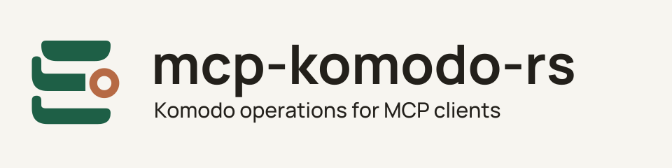

# mcp-komodo-rs

<picture>
  <source media="(max-width: 600px) and (prefers-color-scheme: dark)" srcset="docs/branding/assets/wordmark-dark.svg">
  <source media="(max-width: 600px)" srcset="docs/branding/assets/wordmark-light.svg">
  <source media="(prefers-color-scheme: dark)" srcset="docs/branding/assets/header-dark.svg">
  
</picture>

**Inspect Komodo stacks, deployments, and builds from your MCP client.**

Connect an AI assistant to [Komodo](https://komo.do/) through named tools for
status, deployment operations, and configuration changes. Start locally with
read-only access. Add a gateway when you need authorization and approval
controls for operations that change resources or expose sensitive content.
MCP (Model Context Protocol) lets a client discover and call these tools.

**[Get started](#get-started)** · **[Documentation](docs/README.md)** ·
**[Contribute](CONTRIBUTING.md)** · **[Get help](SUPPORT.md)**

Literal webhook tokens use [native file transfer](docs/file-transfers.md) outside
model context. Token tool calls carry file metadata, and the native runtime
transports the credential bytes. Ordinary content keeps its read/write contract.

## Things to try

**Find a stack and check its state.** Use `stacks.search` to find resources, then
`stacks.status` to inspect one by name or ID. The local profile also includes
status tools for servers, deployments, builds, repositories, and operations.
[Connect a local client](docs/quickstart.md).

**Deploy a change and follow the result.** With the gateway profile and the
required authorization, call `stacks.deploy`, then use the operation receipt to
check progress. An interrupted write may already have reached Komodo;
[reconcile its outcome](docs/reconciliation.md) before trying again.

**Inspect configuration or logs when needed.** Typed reads expose Compose,
environment, configuration, diagnostics, and logs with read credentials. The
operator chooses access, disclosure, and approval policy.
[See the tool reference](docs/tool-surface.md).

**Check network addressing.** Use `servers.networks.search` for one server's
network inventory and `servers.networks.read` for IPAM settings and attached
endpoint addresses. Network addresses, options, and labels remain ordinary facts;
the operator owns disclosure policy.

## Get started

You need Linux, Git, a C compiler/linker, Rust installed through rustup, and an
MCP client that can launch a stdio server. To inspect your resources, you also
need a reachable Komodo Core installation and read-only service-user credentials.
The base wire contract is Core 2.1.2; resource and operation metadata models
also cover Core 2.3.3 fields. Other versions need compatibility checks.
This is an early project with no supported stable release line yet.

```sh
git clone https://github.com/chrisbennight/mcp-komodo-rs.git
cd mcp-komodo-rs
cargo build --release --locked -p komodo-server
```

The checked-in toolchain selects Rust; the first build downloads public
dependencies. The executable is `target/release/komodo-mcp-rs` (the binary name
differs from the repository name).

Add a stdio server to your client's configuration, replacing the path:

```json
{
  "mcpServers": {
    "komodo-status": {
      "command": "/absolute/path/to/mcp-komodo-rs/target/release/komodo-mcp-rs",
      "args": ["--stdio", "--tool-profile", "read-only"]
    }
  }
}
```

Supply these environment variables to the child process through your client's
secret settings or launcher:

| Variable | Value to supply |
| --- | --- |
| `KOMODO_MCP_UPSTREAM_URL` | Your Core base URL, such as `https://komodo.example.com/` |
| `KOMODO_MCP_READ_API_KEY` | A read-only service-user API key |
| `KOMODO_MCP_READ_API_SECRET` | That key's secret |

The server does not load `.env` files itself. Keep credentials out of command
arguments and committed configuration. Client configuration locations and secret
interfaces vary; see the [full quickstart](docs/quickstart.md).

Connect the client and call `system.status` with `{}`. A successful response
includes `reachable: true` and your Core version. Then call `stacks.search` with
`{"limit": 10}` to find a resource. Local stdio needs no gateway or administrative
key. Configuration, diagnostics, and logs are available with read credentials;
the read-only profile excludes mutations.

Without a Komodo installation, you can still check the protocol using the real
binary and a loopback fake Core:

```sh
cargo test --locked -p komodo-server --test stdio
```

This checks initialization, discovery, status and content reads without admin
credentials, and rejection of unavailable operations. It uses a loopback fake. See
[troubleshooting](docs/quickstart.md#troubleshooting) if your client cannot connect.

## Choose an access profile

| Profile | What it provides | What it needs |
| --- | --- | --- |
| Local stdio | All reads; selected mutations when admin credentials are supplied | A local process launcher and read credentials; optional separate admin credentials |
| Gateway HTTP | All typed reads and selected mutations; native credential file transfer | Read credentials, optional separate admin credentials, and a gateway implementing identity, authorization, and approval |

The HTTP endpoint requires a rotating gateway bearer and a verified identity JWT
on every MCP request. A Komodo API key alone cannot authenticate an ordinary
client to it. The gateway owns per-user policy and approvals; tool annotations
do not grant access. [Configure the gateway profile](docs/gateway-setup.md).

Both transports can expose a smaller catalog with `--tool-profile status`, `read-only`, or
`operations`; the default is `full`. See the [capability matrix](docs/configuration.md#select-a-profile)
before choosing: every read-only profile includes content reads; literal credentials require native file transfer.

The server exposes typed, bounded operations. It does not provide a raw Komodo
API proxy, arbitrary shell access, or unrestricted container inspection. Authorized sensitive
reads can return sensitive content to the caller. Komodo may retain submitted
write content in its own traces; see the [tool contract](docs/tool-surface.md)
for the disclosure and failure semantics.

## Go further

The [documentation guide](docs/README.md) covers configuration, operation
recovery, compatibility, and the architecture. The supported container target is
Linux amd64; [builds and releases](docs/releases.md) explains image availability,
publication, and evidence. Other platforms and standalone release binaries are
not currently published.

[Get help or report a bug](SUPPORT.md) · [Contribute](CONTRIBUTING.md) ·
[Report a vulnerability](SECURITY.md) · [License](LICENSE)

## License

[MIT](LICENSE). The original project artwork uses the same license. The bundled
Manrope font retains its [SIL Open Font License](docs/branding/fonts/OFL.txt).
Rust dependency notices are described in [notice provenance](licenses/README.md).
